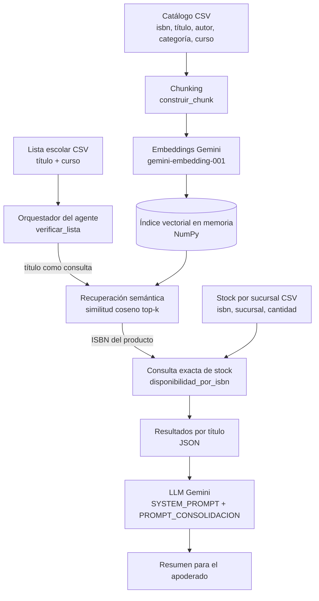

# 📚 Agente de Verificación de Listas Escolares (RAG) — Librería Antártica

**Asignatura:** Ingeniería de Soluciones con IA (ISY0101)
**Evaluación:** Evaluación Parcial N°1 — Diseño de Solución con LLM y RAG
**Integrantes:** [Isaac Marambio], [Matias Oliarte]
**Docente:** [Cristian Andres Carcamo Mansilla] 

[](https://colab.research.google.com/github/TATI3567/ev1-Libreria-antartica/blob/main/proyecto.ipynb)


---

## 📌 Descripción del proyecto

Prototipo de agente basado en **LLM + RAG (Retrieval-Augmented Generation)** para el caso de **Librería Antártica**. El agente recibe la lista de útiles/libros escolares de un estudiante y, para cada título, verifica si existe en el catálogo, en qué sucursal hay stock y qué hacer si no está disponible. Al final redacta un resumen breve para el apoderado.

**Problema que aborda:** la verificación manual de listas escolares (título por título, sucursal por sucursal) es lenta, propensa a errores y se concentra en temporadas de alta demanda.

**Objetivos de la solución**

1. Identificar automáticamente cada título de una lista escolar dentro del catálogo, aunque la escritura no sea exacta (búsqueda semántica).
2. Consultar el stock exacto por ISBN y sucursal, sin que el LLM invente disponibilidad.
3. Entregar un resumen claro al apoderado: qué está disponible, dónde retirarlo y qué requiere reemplazo o encargo.

---

## 🏗️ Arquitectura de la solución




### Componentes

| Componente | Función | Implementación |
|---|---|---|
| Fuentes de datos | Catálogo, stock por sucursal y lista escolar | Archivos CSV en `data/` (datos de muestra) |
| Chunking | Une los campos de cada producto en un texto único | `construir_chunk()` |
| Embeddings | Convierte chunks y consultas en vectores | Gemini `models/gemini-embedding-001` (`google-generativeai`) |
| Índice vectorial | Almacena los vectores del catálogo | Arreglo NumPy en memoria (`construir_indice()`) |
| Recuperación | Top-k por similitud coseno | `buscar()` |
| Consulta exacta | Stock > 0 por ISBN y sucursal | `cargar_stock()`, `disponibilidad_por_isbn()` |
| Orquestación | Flujo multi-paso por cada título de la lista | `verificar_lista()` |
| Generación | Resumen final para el apoderado | `consolidar_resumen_llm()` con Gemini |
| Control de contexto | Reglas de comportamiento del agente | `SYSTEM_PROMPT` (responder solo con el contexto entregado) |

### Flujo de información

1. Se cargan el catálogo, el stock y la lista escolar desde `data/`.
2. Cada producto del catálogo se convierte en un chunk de texto y luego en un embedding.
3. Por cada título de la lista, el agente recupera el producto más similar (top-1) del índice.
4. Con el ISBN recuperado, consulta el stock exacto y elige la sucursal con mayor cantidad.
5. Si no hay stock, marca el título como no disponible y sugiere consultar encargo.
6. Los resultados se consolidan en JSON y el LLM redacta el resumen para el apoderado.

---

## 🧠 Prompts del agente

Definidos en el notebook, en la sección de plantillas de prompt:

| Prompt | Propósito | ¿Usado en el flujo actual? |
|---|---|---|
| `SYSTEM_PROMPT` | Rol del asistente, restricción a responder solo con el contexto, prohibición de inventar datos, cita de sucursal/fuente | Sí |
| `PROMPT_CONSOLIDACION` | Resumen para el apoderado (máx. 8 líneas) a partir de los resultados JSON | Sí |
| `PROMPT_DISPONIBILIDAD` | Consulta libre del cliente con contexto RAG y hasta 2 alternativas | Definido (no conectado al flujo) |
| `PROMPT_VERIFICACION_TITULO` | Salida estructurada en JSON por título | Definido (no conectado al flujo) |

---

## ✅ Requisitos previos

- Python 3.10 o superior (o una cuenta de Google para usar Google Colab).
- Una API Key de **Google AI Studio** (Gemini): https://aistudio.google.com/apikey
- Acceso a internet.

## ⚙️ Instalación

```bash
git clone https://github.com/TU_USUARIO/NOMBRE_DEL_REPO.git
cd NOMBRE_DEL_REPO

python -m venv venv
source venv/bin/activate        # En Windows: venv\Scripts\activate

pip install -r requirements.txt
```

## 🔐 Configuración de variables de entorno

1. Copia el archivo de ejemplo:
   ```bash
   cp .env.example .env           # En Windows: copy .env.example .env
   ```
2. Abre `.env` y completa tus claves:
   ```
   GOOGLE_API_KEY=tu_api_key_de_google_ai_studio
   LLM_API_KEY=tu_api_key
   ```

**Nunca subas el archivo `.env` al repositorio.** Ya está incluido en `.gitignore`. En el repositorio solo debe existir `.env.example`, con los valores vacíos.

> **En Google Colab:** no necesitas el archivo `.env`. Agrega tu clave en el panel de *Secrets* (ícono de llave) o define la variable `GOOGLE_API_KEY` en una celda antes de ejecutar el resto.

## ▶️ Ejecución

1. Abre `proyecto.ipynb` en Jupyter / VS Code, o con el botón de Colab de arriba.
2. Ejecuta **todas las celdas en orden** (*Run All*):
   1. Instalación de librerías.
   2. Carga de variables de entorno.
   3. Generación de los CSV de muestra en `data/` (catálogo, stock y lista escolar).
   4. Definición de los prompts.
   5. Funciones de stock, embeddings y recuperación.
   6. Ejecución del agente (`verificar_lista()`), que imprime el JSON consolidado.
   7. Generación del resumen final con el LLM.

---

## 📊 Ejemplo de uso

**Entrada** (`data/lista_escolar_ejemplo.csv`):

| titulo | curso |
|---|---|
| Papelucho | 3° Básico |
| El Principito | 5° Básico |
| Sub Terra | 1° Medio |

**Salida esperada** de `verificar_lista()` con los datos de muestra:

```json
[
  {
    "titulo": "Papelucho",
    "disponible": true,
    "sucursal": "Mall Costanera Center",
    "cantidad": 5,
    "alternativa_si_no_disponible": null
  },
  {
    "titulo": "El Principito",
    "disponible": true,
    "sucursal": "Mall Costanera Center",
    "cantidad": 2,
    "alternativa_si_no_disponible": null
  },
  {
    "titulo": "Sub Terra",
    "disponible": false,
    "sucursal": null,
    "cantidad": 0,
    "alternativa_si_no_disponible": "Consultar encargo"
  }
]
```

---

## 🧪 Pruebas

| # | Caso de prueba | Resultado esperado |
|---|---|---|
| 1 | Título con stock en una sucursal (Papelucho) | `disponible: true`, Mall Costanera Center, cantidad 5 |
| 2 | Título con stock bajo (El Principito) | `disponible: true`, Mall Costanera Center, cantidad 2 |
| 3 | Título en catálogo sin stock (Sub Terra) | `disponible: false`, `alternativa_si_no_disponible: "Consultar encargo"` |
| 4 | Título escrito con error o variación (ej. "papelucho 3 basico") | Recupera el producto correcto por similitud semántica |
| 5 | Título que no existe en el catálogo | El agente no inventa datos; se registra como no disponible |
| 6 | Sin `GOOGLE_API_KEY` válida | El notebook muestra el aviso y el resumen informa el error controlado |


---

## 📁 Estructura del repositorio

```
├── README.md              # Este documento
├── proyecto.ipynb         # Notebook con el agente y el pipeline RAG
├── requirements.txt       # Dependencias
├── .env.example           # Plantilla de variables de entorno (sin claves reales)
├── .gitignore             # Excluye .env, venv, caches
├── data/                  # CSV de muestra (los genera el notebook)
├── docs/
│   ├── arquitectura.png   # Diagrama de arquitectura
│   └── bocetos/           # Bocetos de diseño
└── evidencias/            # Capturas de pruebas y ejecuciones
```

---

## ⚠️ Alcance y limitaciones actuales

- Los datos de catálogo, stock y lista escolar son **simulados** (muestra de 3 títulos).
- El índice vectorial se reconstruye en memoria en cada ejecución; no hay base vectorial persistente.
- Las fuentes de datos son internas (CSV). [Completar aquí si agregan una fuente externa, por ejemplo una API o sitio web.]
- Los prompts `PROMPT_DISPONIBILIDAD` y `PROMPT_VERIFICACION_TITULO` están definidos pero no forman parte del flujo ejecutado.
- Los modelos de Gemini cambian con el tiempo: si `consolidar_resumen_llm()` devuelve un error de modelo no encontrado, actualiza el nombre del modelo por uno vigente en Google AI Studio.

---

## 🤖 Uso de Inteligencia Artificial


| Herramienta | Para qué se usó |
|---|---|
| [Claude] | [En la elaboración de este documento se utilizó Claude (Anthropic) como apoyo para: estructurar el informe, redactar el borrador de las secciones de análisis del caso, formulación de prompts, diseño del pipeline RAG y arquitectura de la solución, y generar el diagrama de arquitectura. El equipo revisó, validó y ajustó todo el contenido generado para asegurar su coherencia con el caso organizacional y los requerimientos técnicos del proyecto. Las conclusiones y reflexiones individuales fueron redactadas exclusivamente por los integrantes del equipo, sin apoyo de IA.] |
